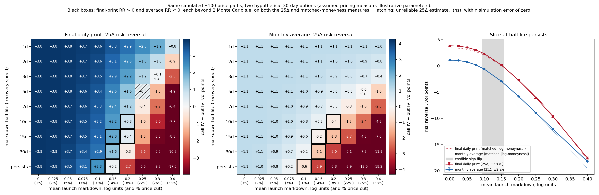

# H100 rental options: can the final print be call-skewed while the monthly average is put-skewed?

*Simulation demo, 16 Nov 2026. Both options are hypothetical. All parameters are illustrative and specified under an assumed pricing measure.*

Run: `python h100_skew_demo.py` (CPU, about 3 minutes, seed 20261116, needs numpy / scipy / matplotlib).
Outputs: `outputs/skew_main_figure.png`, `outputs/grid_results.csv`, `outputs/sensitivity_results.csv`, `outputs/summary.json`, `outputs/run_log.txt`.

## Headline

Yes, but only in a narrow band, and only if upward scarcity spikes are frequent.

- With the baseline spike assumption, the smallest tested markdown that gives a positive final-print risk reversal and a negative monthly-average risk reversal is **0.10 in logs (a 9.5% price cut, about $0.30 at $3.16)**, and it has to **persist through settlement**.
- A markdown that recovers needs to be bigger: 0.15 at a 15- or 30-day half-life, 0.20 at a 10-day half-life. At half-lives of 7 days or less there is no flip at any tested size up to 0.40.
- The band is thin. A persistent markdown of 0.20 or more makes **both** contracts put-skewed. Assody's calibrated generational repricing of 0.22 sits in that both-put region.
- The threshold is **not large relative to observed moves**. Ornn's H100 SXM index fell 12.4% in a single day and 20.6% over 20 days within the last three months. What the data do not show is persistence: observed daily moves mostly reverse.
- The result depends on the spike assumption. With the spike intensity that Lee, Nagaraj and Swem find consistent with published indices (0.5 per year), or with no spikes, there is no credible flip anywhere in the tested grid.

> **Revised by Addendum 2 (closed-form boundary).** Two statements above are too strong. (1) The flip does not need spikes when the launch is likely: above a launch probability of about 0.69 it appears with no spikes at all. (2) With data-consistent spikes a flip band still exists (markdown 0.051 to 0.074), but the risk reversals inside it are about 0.2 vol points, which the grid could not resolve.

## Setup

**Contracts.** Two European options with the same expiry on the same simulated paths: one settles on the final daily print `S_30`, the other on the arithmetic average of the 30 daily prints. The average convention follows the ICE OCPI H100 future (symbol HPR), whose final settlement is the "average of the daily prices on OCPI H100 for the contract month" (ICE spec, Description and Final Settlement rows). Simplifications: the month is 30 daily prints, each print is one value (ICE averages hourly prices into each daily price), and the option is struck at the start of the settlement month. ICE lists no options here; Assody §6.2 notes that an averaging settlement lowers effective variance and smears launch bumps, and recommends leaving the convention as a switch.

**Price process** (daily, log units, all under the assumed measure Q, zero discounting):

`ln S_t = ln S_0 + x_t + r_t + y_t + L_t`

| Component | Specification | Baseline | Source of the idea |
|---|---|---|---|
| Fast noise `x` | OU, AR(1) daily | innovation s.d. 0.042, half-life 1 day | Lee et al. §3.2, eq. (17) |
| Slow level `r` | random walk | s.d. 0.012 per day | Lee et al. §3.2, eq. (18) |
| Scarcity spike `y` | upward jumps, exponential log size, fast decay | 12 per year, mean 0.15, half-life 2 days | Lee et al. §3.2 eq. (19), Table 4 (λ_Y = 12, 1/κ_Y ≈ 2.8 days) |
| Launch markdown `L` | occurs with prob. p on a uniform day; log size lognormal around mean m; decays with half-life h | p = 0.5, days 1–30, size dispersion 30% | Assody §2.3, §3 (event uncertain in size and timing), §5.2 (mean −0.22) |

Sweeps: mean markdown m ∈ {0, 0.025, 0.05, 0.075, 0.10, 0.15, 0.20, 0.25, 0.30, 0.40}; half-life h ∈ {1, 2, 3, 5, 7, 10, 15, 30 days, persistent}. m = 0 is the no-launch control. The spike mean of 0.15 is smaller than Lee et al.'s tail index of 3 implies (0.33); I chose it so that all four moments exist and Monte Carlo errors are well behaved.

**Pricing.** 400,000 paths in 16 blocks, common random numbers across every scenario. Each settlement uses its own simulated mean as the forward. Black-76 implied vols are inverted from out-of-the-money prices. The 25-delta risk reversal is call IV minus put IV at forward deltas of +0.25 and −0.25. Standard errors come from the 16 blocks. A cell counts as a credible flip only if both signs clear 2 standard errors on the 25-delta measure **and** on a matched log-moneyness measure (IV at ±0.6745·σ_ATM·√T), and neither estimate is flagged. One cell is flagged (5-day half-life, m = 0.25, final print: the two measures disagree in sign); it is hatched in the figure and is not near the flip region.

## Results

Risk reversals in vol points (± 1 Monte Carlo s.e.):

| Case | Final print | Monthly average |
|---|---|---|
| No launch (control) | +3.84 ± 0.06 | +1.10 ± 0.02 |
| Deterministic launch (certain, day 10, size 0.20 exactly) | +3.84 ± 0.06 | +1.13 ± 0.02 |
| Persistent, m = 0.075 (just below threshold) | +3.07 ± 0.06 | +0.22 ± 0.02 |
| **Persistent, m = 0.10 (threshold)** | **+2.35 ± 0.06** | **−0.60 ± 0.02** |
| Persistent, m = 0.20 | −2.71 ± 0.06 | −5.81 ± 0.03 |
| 5-day half-life, m = 0.30 | −1.27 ± 0.06 | −0.03 ± 0.02 |

- **Deterministic control.** A launch that is certain in date and size scales the final print by a constant, so its smile is identical to the no-launch smile. All skew effects come from uncertainty, not from the markdown itself.
- **Where both are put-skewed.** 18 of 90 cells: persistent or 30-day half-life at m ≥ 0.20, half-lives of 7–15 days at m ≥ 0.25, 5 days at m = 0.40. A large lasting markdown puts a second, lower mode into both settlement distributions and swamps the spike tail.
- **Fast-recovering markdowns go the other way.** At a 5-day half-life the final print turns put-skewed before the average does. A markdown that fades in days is a downward spike: averaging dilutes it exactly as it dilutes upward spikes, but it hits the final print in full when the launch lands late in the month.

**Worked example (why the payoffs differ).** Additive rule: a shock J present on d of N settlement days moves the arithmetic average by J·d/N. Verified in the script: J = −$0.60 on 10 of 30 days moves every path's average by −$0.20 (maximum error 2e-15); the final print moves −$0.60 if the 10 days include day 30 and $0 otherwise.

Take S = $3.00. A spike of +$0.45 with a 2-day half-life is present for about 3.4 effective days, so it adds 0.45 × 3.4/30 ≈ $0.05 to the average, but the full $0.45 to the final print if it lands at month-end. A persistent −$0.30 markdown launched on day 16 takes the full $0.30 off the final print and $0.15 off the average. Averaging cuts the spike about 9-fold and the markdown only 2-fold. So the average keeps little of the upside tail. Its downside is J·d/N with d random: launch-date uncertainty becomes size uncertainty, on the downside only. The final print carries the same full markdown on every launch path whatever the date, which widens the distribution (ATM vol rises from 32.7% to 38.1%) but adds little asymmetry when p is near one half, so the spike tail still sets the sign.

**Daily-return skew, reported separately.** Sample skewness of daily log returns ln(S_t/S_{t−1}) for t = 1…30 (S_0 fixed), pooling all 30 days of all 400,000 paths (12 million returns): +2.32 with no launch, +2.11 at the threshold case, +1.34 with a persistent 0.20 markdown. Dropping the single launch-day return on launch paths gives +2.32 in every case. Daily-return skew stays strongly positive even where both options are put-skewed, so it does not determine either risk reversal.

## Strongest robustness checks

1. **Independent larger run.** A separate 1.6-million-path run with different seeds reproduces the threshold cell: final print +2.29 ± 0.04, average −0.61 ± 0.01, with the matched-moneyness measure agreeing (+2.06, −0.63). One step below (m = 0.075) the average is +0.22 ± 0.01. The sign change in the average between 0.075 and 0.10 is more than 15 standard errors on each side.
2. **Numerical benchmark.** With a pure random walk the final print is lognormal; the script recovers the analytic vol (38.24% vs 38.21%, s.e. 0.03) and a risk reversal of +0.07 ± 0.06, within about one standard error of the exact value of zero.
3. **Sensitivity of the threshold** (160,000 paths, same random numbers; half-lives 2, 5, 10, 30 days and persistent):

| Change from baseline | Smallest markdown with a credible flip |
|---|---|
| Baseline | 0.10 |
| Launch early (days 1–10) | 0.10 |
| Launch mid-month (days 11–20), or known on day 15 | 0.20, and only for recovering markdowns |
| Launch late (days 21–30) | none |
| Launch probability 0.10 / 0.25 / 0.75 / 1.00 | 0.15 / 0.10 / 0.10 / 0.15 |
| Markdown size known exactly | 0.10 |
| Spike half-life 1 day / 7 days | 0.075 / 0.20 |
| Spikes 0.5 per year, 7-day half-life (Lee et al. §5.11 data-consistent variant) | none |
| No spikes | none |

Launch probability barely matters. Timing matters: a late launch barely moves the average, so no flip. Spike frequency decides whether the final print is call-skewed at all: without frequent spikes the no-launch risk reversals are +0.5 or less and any meaningful markdown makes both contracts put-skewed.

## Ornn data check

- Endpoint: `GET https://api.ornnai.com/api/gpu/H100%20SXM/index-history` (documented at index.ornn.com/docs; no key). Fetched 2026-11-17 07:13 UTC. Raw response saved in `data/ornn_raw/`.
- 91 daily observations, 2026-08-18 to 2026-11-16. The free tier is capped at the trailing three months; a request from 2025-01-01 returned the same 91 rows.
- No missing calendar dates and no duplicates, so nothing was filled or dropped. Horizons below are counts of consecutive daily observations.
- Level: $2.46 to $3.53, last $3.16.

| Horizon | Largest up | Largest down | S.d. of log change |
|---|---|---|---|
| 1 observation | +12.4% (+0.117 log, +$0.36) | −12.4% (−0.132 log, −$0.39) | 0.055 |
| 5 observations | +20.9% (+0.190) | −14.7% (−0.159) | 0.081 |
| 20 observations | +20.1% (+0.183) | −20.6% (−0.231) | 0.093 |

Median absolute one-day move: 0.035 in logs ($0.10). The simulated launch-free process matches this by construction (0.035), and is about 20% more dispersed at every horizon (s.d. 0.065 / 0.100 / 0.114) because of the assumed spikes.

**Threshold against observed moves.** The 0.10 threshold is 2.9 times the median one-day move, 0.76 times the largest observed one-day fall, and roughly one standard deviation of an ordinary 20-day change (0.093). As a size it is unremarkable. The demanding part is persistence: the observed 20-day s.d. is 0.093 against 0.25 if daily moves accumulated like a random walk, so most daily moves in this window reverse within days. A markdown that reverses that fast (half-life ≤ 7 days) never produces the flip. Recovering markdowns with a 10-day half-life need 0.20, which is the size of the largest observed 20-day fall and of Assody's −0.22.

The window also shows no scarcity spikes: the largest daily rise is 2.1 daily standard deviations and daily-change skewness is −0.13 (n = 90), against +2.3 in the model. That agrees with Lee et al. §5.11, where the published indices reject λ_Y = 12.

## Pricing measure

Every number above is a Q-measure statement about a Q-measure process I assumed. The Ornn statistics are realised moves under the physical measure. The comparison therefore puts a physical scale next to risk-neutral parameters; it does not test them.

- Launch probability, markdown size and spike intensity are risk-neutral quantities. Lee et al. §3.6 tilt spike sizes under Q (heavier tail than under P), which would push the final print further toward call skew; a premium for obsolescence risk (Assody, abstract) would raise the risk-neutral launch probability or size and push toward put skew.
- Spot compute is not storable or tradable, so the market is incomplete and Q is not unique (Lee et al. §4.1; option bounds in §4.5). The sign of either risk reversal is not pinned down by no-arbitrage.
- Using each settlement's simulated mean as its forward removes any dependence on drift, so the result is about distribution shape only.

## What data would settle it

- **Launch-window rental data.** Daily index prints through a completed transition (the H100 across the Blackwell ramp) would show when the repricing lands relative to the announced window, whether it is a step or a dip that recovers, and how dispersed the size is. Persistence is the parameter this experiment is most sensitive to, and three months of free history contain no launch. It needs the keyed Ornn history or the Silicon Data series used in Assody §5.2.
- **Traded options.** Quotes at 25-delta put, ATM and 25-delta call on (a) the average-settled HPR future and (b) a contract settling on a single daily print, for the same delivery month, plus the futures prices for the forwards. Months before, during and after a launch window would separate launch skew from spike skew.

## Main limitation

The sign flip is produced by an assumed spike process that the published indices, and the three months of Ornn data here, do not support at the assumed frequency. With data-consistent spikes the honest conclusion is that launch uncertainty makes both contracts put-skewed, the average more so. Other limits: one delivery month only (the expiry extension was skipped), the grid is coarse so "smallest" means smallest tested, 25-delta strikes sit only 3–8% from the forward, and nothing is calibrated to option prices because none exist.

---

## Addendum: repricing through the month while the launch has not happened

Run: `python h100_conditional_demo.py` (about 30 seconds). Outputs: `outputs/conditional_repricing_figure.png`, `outputs/conditional_repricing.json`, `outputs/conditional_run_log.txt`.

**Answer.** The original sign flip does not survive the month. It is present on day 0, the average's risk reversal is indistinguishable from zero by day 10, and by day 20 both options are call-skewed. The final print stays call-skewed throughout. Updating the launch probability explains little of this; most of it comes from the shrinking number of days a launch can still affect.

**Setup.** Same baseline spot model and the persistent 0.10 log markdown case, same day-30 settlement, 400,000 continuation paths per date.
- One explicit illustrative history is used at every date (seeded draw from the baseline fast-noise and slow-level factors, no spike in the history). Prints for days 1–20: 3.17 3.00 2.98 2.96 3.00 3.14 2.99 2.84 2.98 3.04 | 3.00 3.13 3.10 2.99 3.06 2.95 3.02 2.92 3.02 2.94. Past prints are fixed numbers in the average, and the factor state on the valuation day starts every continuation. The factor states are taken as known, which a real desk would have to filter.
- Conditioning on no launch yet uses Bayes' rule inside the existing model: P(launch in the remaining days) = p(30−t)/30 ÷ (1 − p·t/30), which is 0.50, 0.40 and 0.25 on days 0, 10 and 20. The launch day is uniform on the remaining days; the rest is the no-launch-this-month outcome.
- Vols use the conditional forward and the remaining time to expiry. The average option's vol is quoted on the whole-month average, so it falls mechanically as prints fix.
- Control: remaining launch probability held at 0.50 with the same remaining launch-date distribution, on the same random numbers.

**Results** (25-delta risk reversal in vol points, ± 1 s.e.):

| Valuation day | P(launch left) | Final print | Monthly average | Average, probability held at 0.50 | Final, probability held at 0.50 |
|---|---|---|---|---|---|
| 0 | 0.50 | +2.25 ± 0.08 | −0.62 ± 0.02 | −0.62 | +2.25 |
| 10 | 0.40 | +2.50 ± 0.10 | +0.01 ± 0.03 | −0.02 ± 0.03 | +2.94 ± 0.10 |
| 20 | 0.25 | +3.40 ± 0.10 | +0.99 ± 0.03 | +0.60 ± 0.02 | +3.97 ± 0.09 |
| 10, launch observed | 0 | +5.22 ± 0.09 | +1.67 ± 0.02 | n/a | n/a |

Day 0 reproduces the original threshold cell (+2.35, −0.60) within simulation error on fresh random numbers. Intermediate days 5, 15 and 25 are in the chart and the JSON; the average is still negative on day 5 (−0.34) and positive from day 15 (+0.46).

**Why the flip fades.** A launch on a later day can only dent the average by J × (days left)/30: at most 0.067 from day 10 and 0.033 from day 20, against 0.10 on day 0. That dent shrinks in proportion to the days left, so the launch's downside asymmetry (its third cumulant) shrinks with the cube of the days left, while the spikes' upside asymmetry shrinks only in proportion to them. So the launch loses its grip on the average and the spike tail takes the sign back. (Addendum 2 derives this.)

**How much is the probability update?** For the average, holding the probability at 0.50 still moves the risk reversal from −0.62 to −0.02 on day 10 and to +0.60 on day 20. The update adds +0.03 on day 10 (inside simulation error) and +0.39 on day 20, about a quarter of the total move by then. For the final print the update works the other way through day 20: a lower launch probability makes the markdown the minority outcome, which adds downside asymmetry, so the updated risk reversal sits 0.4–0.6 points below the held one.

**Final print.** Its risk reversal rises in vol points mainly because its ATM vol rises (38% to 53%) as the fast noise is spread over less time. Scaled by ATM vol it is flat at about 0.06 through day 20.

**Launch observed on day 10.** Days 1–9 are the same history; the day-10 print is 3.04 × e^−0.10 = $2.75 and the markdown stays. No launch uncertainty remains, so both options are call-skewed (+5.22 and +1.67) and ATM vol drops (final 42.8% to 36.2%, average 15.5% to 12.4%). The flip exists only while the launch is unresolved and early enough in the month to move the average.

**Caveat.** These are results for one illustrative history with no spike in it; a different state on the valuation day (for example a spike in progress) would shift the levels. The day-10 average reading is zero within error, so "gone by day 10" means no longer credibly negative, not credibly positive.

---

## Addendum 2: a closed-form rule for the sign boundary

Run: `python h100_boundary_theory.py` (about 3 minutes; run the two earlier scripts first). Outputs: `outputs/boundary_theory_figure.png`, `outputs/boundary_theory.json`, `outputs/boundary_run_log.txt`.

### The rule

The log settlement is a sum of independent pieces: Gaussian noise (no skew), upward spikes (positive third cumulant) and the launch markdown (negative third cumulant, proportional to m³). Skewness changes sign where the two cancel:

**m\* = (κ₃ spike / c)^(1/3)**

- κ₃ spike = q μ³ (6 − 6q + 2q²) Σⱼ aⱼ³, with q the daily spike probability, μ the mean log spike and aⱼ the loading of a spike that arrives j days before month-end.
- c = p e^(3s²) A₃ − 3 p² e^(s²) A₂ A₁ + 2 p³ A₁³, with p the launch probability, s the size dispersion and Aₙ the average over launch days of (launch loading)ⁿ.
- Loadings are the only place the settlement convention enters. Final print: φʲ for a spike, ρʲ for the markdown (φ, ρ the daily decay factors). Average: (1 − φʲ⁺¹)/((1 − φ)N) for a spike, (j + 1)/N for a persistent markdown.

For a persistent markdown with the launch day uniform over the month this reduces to:

- **Average:** m\* ≈ μ × (D/N) × (6Λ / c_avg)^(1/3), where D = 1/(1 − φ) is the spike's effective duration (3.4 days), Λ is spikes per month, and c_avg = p e^(3s²)/4 − p² e^(s²)/2 + p³/4.
- **Final print:** m\* ≈ μ × (6q / ((1 − φ³) c_fin))^(1/3), with c_fin = p e^(3s²) − 3p² e^(s²) + 2p³.

In words: the average turns put-skewed when the markdown exceeds roughly the spike size, times the share of the month a spike lasts, times a cube-root factor. For a markdown that recovers over D_m days the share D/N becomes D/D_m, the ratio of spike duration to markdown duration.

### How well it works

A second tool checks the rule: the characteristic function of the log settlement is a product of closed-form factors, so one FFT gives the density and the 25-delta risk reversal with no Monte Carlo. Across all 90 cells of the original grid it matches the simulation to a median 0.10 (final) and 0.05 (average) vol points, maximum 0.14, on risk reversals that range from +4 to −18. For the final print it is exact; for the average it is about 0.1 vol point low because interactions between shocks are approximated.

Markdown at which the 25-delta risk reversal changes sign (baseline, launch probability 0.5):

| Half-life | Average: simulation | Average: semi-analytic | Average: rule | Final: simulation | Final: semi-analytic | Final: rule |
|---|---|---|---|---|---|---|
| 5 days | 0.296 | 0.287 | 0.262 | 0.259 | 0.257 | 0.293 |
| 7 days | 0.223 | 0.217 | 0.201 | 0.238 | 0.237 | 0.284 |
| 10 days | 0.173 | 0.170 | 0.158 | 0.223 | 0.223 | 0.279 |
| 30 days | 0.108 | 0.106 | 0.098 | 0.192 | 0.192 | 0.270 |
| Persistent | 0.082 | 0.080 | 0.073 | 0.153 | 0.152 | 0.228 |

- **Average.** The rule is within about 10% of the 25-delta boundary here, and across 36 other spike settings the ratio stays between 0.92 and 1.26 (median 1.09).
- **Final print.** The rule gives the skewness boundary exactly (simulated skewness zero 0.227 against 0.228), but the 25-delta boundary sits at about two thirds of it (ratio 0.58 to 0.76). Rare large spikes dominate the third cumulant yet lie beyond the 25-delta strike. The 10-delta boundary is 0.188, between the two.
- **The flip band** is the gap between the two solid curves in the left panel. It opens at a half-life of about 6 days and is 0.080 to 0.152 for a persistent markdown.

### What the rule shows

1. **Spike frequency matters least.** The threshold is linear in spike size and spike duration but goes with the cube root of frequency. Cutting frequency 24-fold (12 to 0.5 per year) lowers the boundaries only about 3-fold. So with Lee et al.'s data-consistent spikes the band still exists, at 0.051 to 0.074 for a persistent markdown. What collapses is the size of the skew: the risk reversals inside that band are about +0.2 and −0.2 vol points, against +1.7 and −1.4 at baseline. The original grid, with tested sizes of 0.05 and 0.075, stepped over it.

2. **A likely launch produces the flip without any spikes.** c_fin changes sign at p = [3e^(s²) − √(9e^(2s²) − 8e^(3s²))]/4, which is 0.685 at baseline (0.5 if the size is known exactly), and stays negative up to 0.955. In that range "no launch" is the surprise, and it is an upside surprise for the final print, so the launch itself makes the final print call-skewed. c_avg is positive for every p, so the average is always pushed toward put skew. Simulation with spikes switched off confirms it (25-delta risk reversals, vol points):

| Launch probability | Markdown | Final print | Monthly average |
|---|---|---|---|
| 0.8 | 0.10 | +0.35 ± 0.03 | −1.03 ± 0.02 |
| 0.8 | 0.20 | +2.56 ± 0.04 | −4.07 ± 0.03 |
| 0.9 | 0.10 | +0.28 ± 0.04 | −0.85 ± 0.02 |
| 0.6 | 0.10 | −0.34 ± 0.04 | −1.44 ± 0.02 |

   This is the case closest to Assody §3, where the event is certain within its window. If one delivery month covers most of that window, the flip follows from launch timing alone and the spike assumption is not needed.

3. **The band closes from both sides as the month runs.** With the probability updated, the 25-delta boundaries for a persistent markdown are:

| Valuation day | Average turns put-skewed above | Final turns put-skewed above |
|---|---|---|
| 0 | 0.080 | 0.152 |
| 10 | 0.096 | 0.132 |
| 20 | 0.130 | 0.127 |

   By day 20 no markdown size gives a flip. With the probability held at 0.50 the band is still open on day 20 (0.114 to 0.139), so the probability update is what closes it, even though it mattered little for the 0.10 case. In the continuous limit the average's threshold rises as (days left)^(−2/3); with exact daily sums the rule gives 1.26× by day 10 and 1.75× by day 20, and the 25-delta boundary rises 1.19× and 1.43×. The exponent overstates the rise late in the month.

### Limits

- The rule is a skewness rule. It tracks the 25-delta boundary for the average but needs the two-thirds correction for the final print, and that factor is empirical.
- For the average the rule uses log-linear loadings. The true skewness zero of the arithmetic average is higher (0.088 persistent, 0.194 at a 10-day half-life, against 0.073 and 0.158), and it is undefined when the mean log spike is 1/3 or more, which is the tail index of 3 in Lee et al.'s baseline.
- In the conditional comparison the semi-analytic curve is about 0.15 vol points below the simulation for the average, so it puts the zero crossing near day 12 where the simulation has day 10.
- Everything remains under the assumed pricing measure with illustrative parameters.
