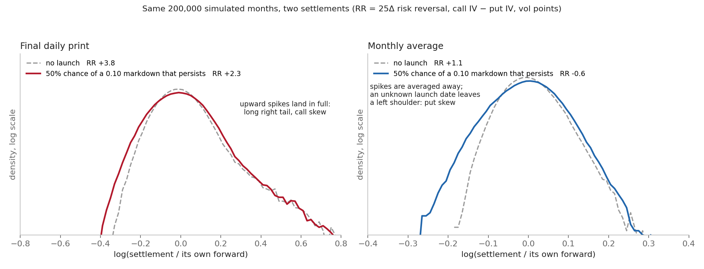
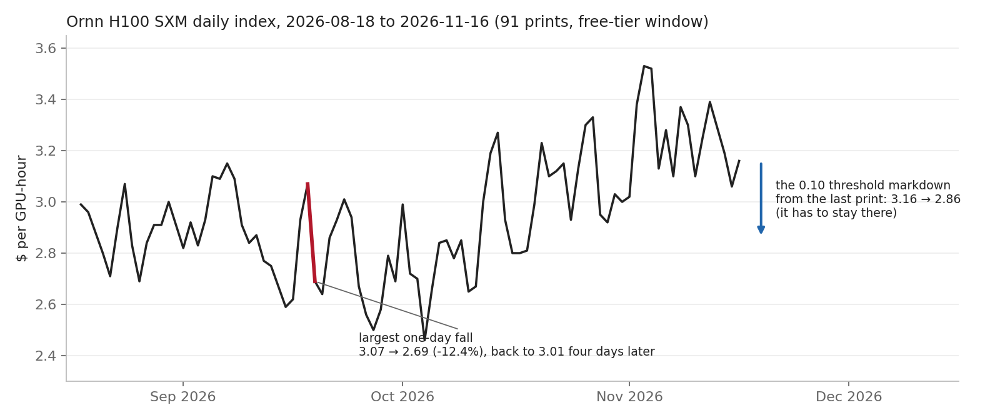
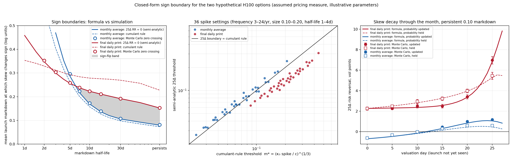
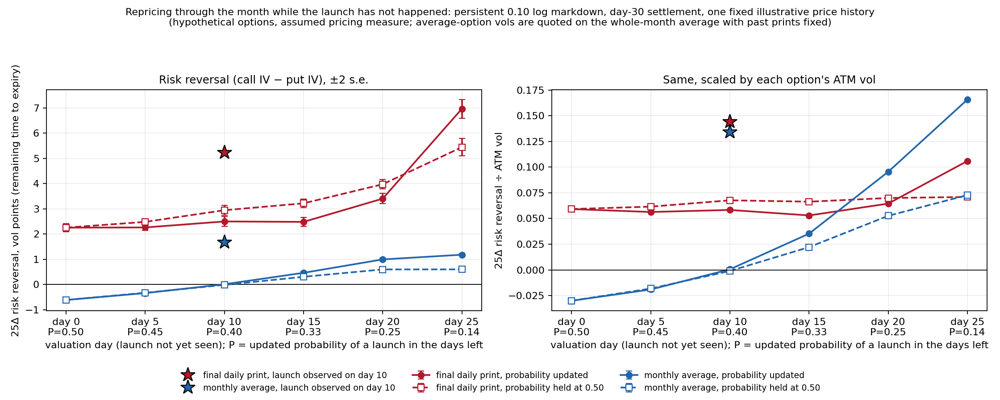

# Two H100 options, one price path, opposite skews

ICE's new H100 rental future (HPR) settles on the average of a month of daily index prints. Imagine options on that average, and options on a single print, the last day of the month. Same GPU, same rental price. Can one be call-skewed while the other is put-skewed?

In this model, yes. The final print leans toward calls because short scarcity spikes hit it in full. The average leans toward puts when a new-hardware markdown might land on an unknown day. The overlap is narrow, and it closes as the month goes on. Everything here is simulated under a pricing measure I chose; neither option trades.

> **Data credit.** The H100 SXM GPU rental price index data in `data/ornn_raw/` comes from [Ornn](https://index.ornn.com) (free public API, `api.ornnai.com`, documented at [index.ornn.com/docs](https://index.ornn.com/docs)), fetched 2026-11-17 07:13 UTC. All credit for that data belongs to Ornn; it is included here only to make the analysis reproducible. This project is not affiliated with or endorsed by Ornn.

## The model

A daily log price with four parts. The first three follow Lee, Nagaraj and Swem (2026, §3.2); the markdown follows Assody (2026, §2.3, §3).

| Part | What it does | Baseline |
|---|---|---|
| Fast noise | day-to-day wobble that reverts | s.d. 0.042 a day, half-life 1 day (matches Ornn's median daily move) |
| Slow level | drifts over weeks | s.d. 0.012 a day |
| Scarcity spikes | short upward jumps | 12 a year, average size 0.15 in logs, half-life 2 days |
| Launch markdown | a downward step that may arrive this month | 50% chance, uniform day, mean size *m*, half-life *h* or permanent |

The month is 30 prints starting at $3.00. Skew is the 25-delta risk reversal (call vol minus put vol, from Black-76 with each settlement's own forward), on 400,000 paths. A sign only counts if it clears two standard errors.

## Why the two contracts disagree



A $0.45 spike with a 2-day half-life lasts about 3.4 prints' worth. If it lands at month-end the final print takes all of it, while the average moves $0.05. The final print keeps its long right tail; the average loses most of it.

The markdown runs the other way. A permanent $0.30 cut takes $0.30 off the final print whichever day it lands. Off the average it takes $0.30 if it lands on day 1, $0.15 on day 16 and $0.01 on day 30, because a shock present on d of N days moves the average by d/N of its size. Not knowing the date turns into not knowing the size of the hit, on the downside only. That left shoulder is the put skew.

A launch that is certain in date and size changes neither skew (+3.84 and +1.13, against +3.84 and +1.10 with no launch). Uncertainty does all the work.

## How big the markdown has to be


Black boxes mark the flip. The smallest tested markdown that gets there is 0.10 in logs, a 9.5% cut or about $0.30 at today's $3.16, and it has to be permanent.

| Case (permanent unless noted) | Final print | Monthly average |
|---|---|---|
| No launch | +3.84 | +1.10 |
| *m* = 0.075 | +3.07 | +0.22 |
| ***m* = 0.10** | **+2.35** | **−0.60** |
| *m* = 0.20 | −2.71 | −5.81 |
| *m* = 0.30, 5-day half-life | −1.27 | −0.03 |

Vol points; errors are 0.02 to 0.06. A separate 1.6-million-path run gives +2.29 and −0.61 for *m* = 0.10.

At 0.20 and above both go put-skewed, which includes Assody's calibrated repricing of −0.22 (§5.2). Markdowns that fade need to be bigger, and with a half-life under about 6 days the flip never appears: a short markdown is just a downward spike, and the average dilutes it like any other.

## Is 0.10 a big move?



Not lately. Ornn's free API gives 91 consecutive daily prints, 18 Aug to 16 Nov 2026, with no gaps.

| Horizon | Largest rise | Largest fall | S.d. of log change |
|---|---|---|---|
| 1 day | +12.4% | −12.4% | 0.055 |
| 5 days | +20.9% | −14.7% | 0.081 |
| 20 days | +20.1% | −20.6% | 0.093 |

The median daily move is 0.035 in logs, about $0.10. So 0.10 is three ordinary days, or less than the biggest single-day fall.

Size isn't the problem; staying power is. If daily moves accumulated like a random walk, the 20-day s.d. would be about 0.25. It is 0.093, so most moves reverse within days. The 12% fall in the chart was back above $3.00 four days later.

The data also show none of the spikes the model assumes. Daily changes have skewness of −0.13, against +2.3 simulated, and Lee et al. reject 12 spikes a year on longer histories (§5.11).

## A formula for the boundary

That gap pushed me to write the boundary down. The pieces of the log settlement are independent, so their third cumulants add: spikes contribute a positive amount, the markdown a negative one proportional to *m*³. Skewness changes sign where they cancel:

**m\* = (spike third cumulant / c)^(1/3)**

*c* depends on the launch odds, the spread in markdown size and the launch-day distribution. The settlement convention only enters through how much of each shock reaches the settlement. For the average it comes down to roughly *spike size × (spike duration ÷ month length) × a cube-root factor*.



The same independence gives the characteristic function in closed form, so one FFT prices the whole smile without simulation. It matches all 90 simulated cells to a median of 0.05 vol points for the average and 0.10 for the final print.

| Markdown half-life | Average turns put above (simulated / rule) | Final turns put above (simulated / rule) |
|---|---|---|
| 5 days | 0.296 / 0.262 | 0.259 / 0.293 |
| 10 days | 0.173 / 0.158 | 0.223 / 0.279 |
| 30 days | 0.108 / 0.098 | 0.192 / 0.270 |
| Permanent | 0.082 / 0.073 | 0.153 / 0.228 |

The rule is within about 10% for the average. For the final print it gets the skewness zero exactly, but the risk reversal flips at about two thirds of that, because the big spikes driving skewness sit beyond the 25-delta strike.

The formula caught two things the grid missed.

**Spike frequency barely matters.** It enters through a cube root, so cutting spikes from 12 a year to 0.5 shrinks the thresholds about threefold, not 24-fold. Under Lee et al.'s data-consistent setting (0.5 a year, each lasting about a week) the flip survives for permanent markdowns of 0.051 to 0.074. But the skews there are around ±0.2 vol points, and the grid's 0.05 and 0.075 steps jumped right over the band.

**A likely launch does it without spikes.** Above a launch probability of about 0.69, "no launch" becomes the surprise, and for the final print it's an upside one. The average leans to puts at any probability. With spikes switched off:

| Launch probability | Markdown | Final print | Monthly average |
|---|---|---|---|
| 0.6 | 0.10 | −0.34 | −1.44 |
| 0.8 | 0.10 | +0.35 | −1.03 |
| 0.8 | 0.20 | +2.56 | −4.07 |

That is close to Assody's setup, where each launch window holds one event that is certain to happen (§3). If a delivery month spans most of an announced window, timing alone gives opposite skews, spikes or not.

## During the month

Re-pricing on days 10 and 20 with no launch yet, a fixed price history and the launch odds updated by Bayes' rule:



| Valuation day | Chance a launch is still coming | Final print | Monthly average |
|---|---|---|---|
| 0 | 0.50 | +2.25 | −0.62 |
| 10 | 0.40 | +2.50 | +0.01 |
| 20 | 0.25 | +3.40 | +0.99 |
| 10, launch just happened | n/a | +5.22 | +1.67 |

After day 20 a launch can touch at most a third of the average, so its downside shrinks with the cube of the days left while the spike effect shrinks only in proportion. That, more than the lower odds, is what kills the flip. Across all markdown sizes the band narrows from 0.080–0.152 on day 0 to 0.096–0.132 on day 10 and is gone by day 20. Once the launch has happened, both options are back to call skew.

## Limits

The pricing measure is mine. Compute can't be stored, so the market is incomplete and no-arbitrage doesn't pin the measure down (Lee et al. §4.1). A premium on spike risk would push the final print further toward calls; a premium on obsolescence would push both toward puts.

The Ornn data set a scale but test nothing: three months with no launch and no spikes can't say anything about persistence or launch timing, which matter most here. I also priced only one delivery month, used one price history for the conditional runs, and the final-print rule needs a fitted correction.

## What would settle it

Daily prints through a finished transition, such as the H100 across the Blackwell ramp, would show where in a launch window the repricing lands and whether it sticks. Quotes on an average-settled and a single-print option for the same month, around a launch window, would test the skews directly. Neither exists yet.

## Running it

Python 3 with numpy, scipy and matplotlib. CPU only, fixed seeds. Run in order; later scripts read earlier outputs.

```bash
python h100_skew_demo.py          # main sweep, controls, sensitivity, Ornn stats (~3 min)
python h100_conditional_demo.py   # day-by-day re-pricing (~30 s)
python h100_boundary_theory.py    # formula, FFT pricer and checks (~3 min)
python make_readme_figures.py     # distribution and Ornn charts (~15 s)
```

Figures, CSVs and JSON go to `outputs/`. [RESEARCH_NOTE.md](RESEARCH_NOTE.md) is the long version, with every check, the full sensitivity table and the derivation.

## Sources

- ICE Futures U.S., *Ornn Compute Price Index (OCPI) H100 Future, contract specifications* (HPR).
- Lee, S. J., S. Nagaraj and N. Swem (2026), *Pricing, Hedging, and Securitizing AI Compute*, SSRN 7342241.
- Assody, A. (2026), *Pricing compute futures*, SSRN 6926798.
